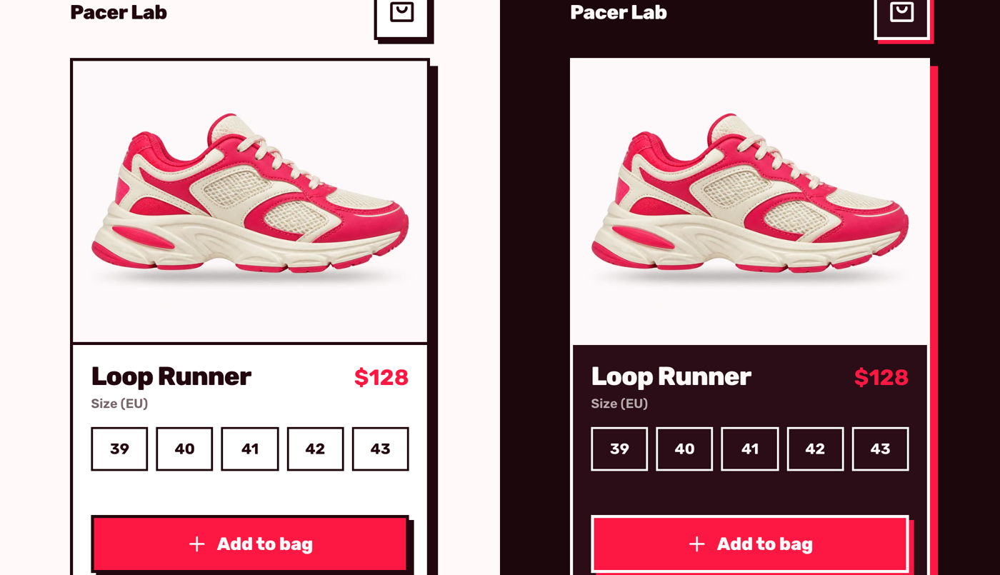

# Add to Bag

Pick a size, tap **Add to bag**, and a round cut of the product photo flies in an arc into the bag. The bag opens to catch it, wobbles, and its counter rolls to the new number while the button turns into a confirmation. Tap without a size and the sizes shake and ask for one first.



**[Live demo](https://arslanagayev.github.io/add-to-cart-animation/)** · **[Reel mode](https://arslanagayev.github.io/add-to-cart-animation/?reel)** · UI animation #08 of a weekly series on Instagram [@arslanagayev.dev](https://www.instagram.com/arslanagayev.dev/)

Plain **HTML, CSS and JavaScript**: no frameworks, no build step, no runtime dependencies.

## How it works

1. **Size first.** The sizes are real radio buttons. Adding without one shakes the row, shows a hint and announces it to screen readers.
2. **The arc.** Two nested elements draw the curve with no path maths: the outer one slides sideways at a steady pace while the inner one rises and then drops. Both are Web Animations API calls with the same duration, so they land together.
3. **Staying on screen.** The top of the arc is clamped inside the window, so it still works when the bag sits right at the top edge.
4. **The catch.** The bag icon switches to its open version during the flight, closes on arrival, wobbles, and the badge pops (or the old number slides up and the new one slides in).
5. **The button.** The label slides up and a check with the chosen size slides in, then it goes back to **Add to bag** for the next one.

## The key code

```js
// The outer box slides sideways, the inner one rises and drops: together they draw an arc.
outer.animate({ translate: [`${x0}px 0`, `${x1}px 0`] }, { duration: 900, fill: 'forwards' });
inner.animate([
  { translate: `0 ${y0}px`, scale: 0.5, opacity: 0 },
  { translate: `0 ${y0 - 20}px`, scale: 1.1, opacity: 1, offset: 0.18 },
  { translate: `0 ${peak}px`, scale: 0.85, offset: 0.5 },
  { translate: `0 ${y1}px`, scale: 0.3 },
], { duration: 900, fill: 'forwards' });
```

## Features

- Bold block style in True Pink and Chill White: square corners, ink outlines and hard offset shadows
- Light and dark themes from `prefers-color-scheme`
- `prefers-reduced-motion`: no flight, the counter just updates
- Real `<button>`s and radio inputs, visible focus rings, an `aria-live` status and a bag label that says how many items it holds
- Rubik, self-hosted (`assets/fonts`, SIL Open Font License); icons from [Phosphor](https://phosphoricons.com) (MIT), inlined as SVG
- The product photo was generated with Canva for this demo; the shoe and the Pacer Lab shop are fictional

## Use it in your project

Copy `index.html`, `style.css`, `script.js`, `reel/theme.css` (colour tokens and the font) and `assets/`. The `reel/` scripts only power the reel mode below; to drop them, delete the `mountReel(...)` call at the end of `script.js` and the `isAutoplay` import and check.

## Reel mode

Add `?reel` to the URL and the page becomes a self-playing 1080×1920 stage with a title, a scripted cursor, a code excerpt (left out when the demo needs the room) and an end card. `?autoplay` loops the scripted demo without the frame. Options: `&ratio=4x5`, `&nocode`, `&delay=3000`.

## Run locally

ES modules don't load from `file://`, so serve the folder:

```bash
git clone https://github.com/arslanagayev/add-to-cart-animation.git
cd add-to-cart-animation
python3 -m http.server 8000
```

Then open <http://localhost:8000>.

## License

[MIT](LICENSE) for the code. Rubik is under the SIL Open Font License ([assets/fonts/LICENSE-OFL.txt](assets/fonts/LICENSE-OFL.txt)).
